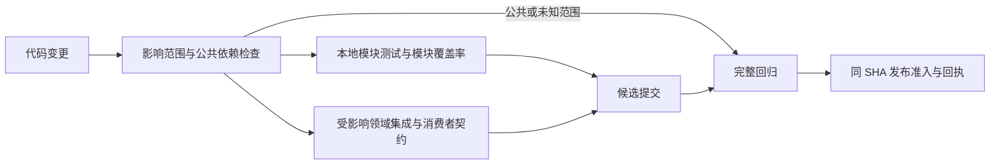

# CI 分层与模块回归

沿用 [发布耗时 Dossier](../dossiers/2026-10-27-release-latency-optimization.md)。本设计区分当前实测、已实现的本地反馈入口与尚未启用的 CI / 发布策略。当前 main 的完整发布准入不变；模块反馈不能签发发布资格。

## 当前耗时：先看最后完成的执行链

来源：[完整 CI 40469166838](https://github.com/itsoso/health-llm-driven/actions/runs/40469166838)，SHA `ea55da9c01c50154f460bd208666e3f76686dbb5`，首轮成功。完整分段见 `docs/reviews/2026-10-27-ci-stage-breakdown.json`；由现有 `scripts/release_performance_report.py` 自动生成。以下阶段严格相加为 573 秒：

| 最后完成的后端 job 时间线 | 秒 | 可以采取的措施 |
| --- | ---: | --- |
| run 创建至 job 开始 | 15 | 已不占主要耗时；该数包含依赖和调度，不能称为纯排队 |
| 环境初始化 / checkout / Pi 工具链 | 25 | 工具链按锁定版本复用；先测冷/热环境，不盲换 runner |
| Python 依赖安装 | 16 | 已做按需字节码编译；进一步缓存的最大收益受该段限制 |
| 测试执行 | 499 | 模块反馈、测试层级拆分、fixture 边界、重复执行热点 |
| 其他已记录步骤 | 2 | 非主要瓶颈 |
| job 内未归属时间 | 5 | 明确保留，不能捏造为安装或测试时间 |
| 最后工作 job 完成至汇总结束 | 11 | 保留必需的聚合/发布准入语义 |

其他检查与上述后端任务并行，不能把它们相加当作总耗时：

| 检查 | run 创建后开始 | 执行时间 | 完成时刻 |
| --- | ---: | ---: | ---: |
| PostgreSQL | 14 秒 | 476 秒 | 第 490 秒 |
| 后端质量 | 15 秒 | 206 秒 | 第 221 秒 |
| 发布不变量 | 34 秒 | 287 秒 | 第 321 秒 |
| Web 测试和构建 | 223 秒 | 122 秒 | 第 345 秒 |
| Mobile 类型和测试 | 326 秒 | 163 秒 | 第 489 秒 |

Web/Mobile 的启动延迟很长，但这一轮都没有决定最终完成时间。只优化它们无法直接把 573 秒降到五分钟。即使完全消除最后后端 job 的安装阶段，理论上也只省 16 秒；测试执行必须成为重点。

## 本轮候选完整 CI 验证

[40478780352](https://github.com/itsoso/health-llm-driven/actions/runs/40478780352) 首轮 32/32 job 通过，但全量为 643 秒，紧邻主干为 546 秒，不能宣称完整 CI 提速。本轮工具不改变 CI 的测试执行方式。最新关键路径为启动 17、环境 22、安装 18、测试 505、其他步骤 2、未归属 63、收尾 16 秒。

特别是最后 step 完成至 job 完成有 62 秒间隔，归属未知。该间隔单独保留，不能靠减少测试“解释掉”，也不能猜测是网络或 runner 回收。下一轮需区分测试长尾与平台完成事件延迟；证据见 `docs/reviews/2026-10-27-ci-module-feedback-production.json`。前面的 573 秒是既有结构分析样本，最新结果完整保留，不挑最快一次。

## 结构性原因

后续已验证的执行优化：`0633a4d02784abb465534faa86e19f68a3613926` 在单次同步读取操作内消除重复 projection / request 解析，没有跨调用缓存或测试选集变更。[CI 40484148406](https://github.com/itsoso/health-llm-driven/actions/runs/40484148406) 首轮全绿，完整 520 秒；最后工作分片分段为启动 16、环境 26、安装 17、测试 445、其他 3、未归属 4、收尾 9 秒。原 35,788 条测试结果保留，新增 3 项通过。对照前轮 643 秒中有 59 秒改善来自未归属时间，不能全算作代码收益；更早 546 秒样本也保留在 Dossier。此结果再次支持优先剖析执行热点，而非继续盲增 worker 或只优化安装。

后续 Agent 应先复用 `release_performance_report.py` 和原始 JUnit/子进程日志建立同源基线，再做同一测试集合对照。可复用一次不可变调用内的纯中间值，但不能仅凭参数相同缓存鉴权结果；跨调用 owner/date、撤回、引用、可变返回值和异常传播仍需负向回归。阶段七的本地配方、完整 CI 集合与时间证据均在现有 Dossier 链接，不把部署预检当作线上交付。

- `scripts/ci_change_scope.py` 已对 local/PR 区分端侧，但非文档 main push 强制 full。这样能让主干首轮结果直接满足现有发布器，而不需要随后再派发一遍全量 CI。
- `scripts/release-preflight.sh` 对后端改动做治理和类型检查，目前没有自动运行模块测试；不能把“preflight passed”当成后端行为回归通过。
- `backend/tests/conftest.py` 在收集阶段导入 `main.app`，根 autouse fixture 还涉及 API limiter 和 Twin cache。文件位于 `tests/unit/` 并不会自动隔离祖先 conftest；需要实际调整 fixture 的可见范围。见 [pytest fixture 规则](https://www.pytest.org/en/latest/reference/fixtures.html)。
- `.github/ci/backend-pytest-shards.json` 主要按文件名与耗时组织进程，不是可证明完整的业务影响图。`System Map` 的 runtime dependency 覆盖也是 partial/declaration，不能直接用它排除测试。
- 当前 `backend/pytest.ini` 默认对整个 app 生成 term-missing 和 HTML 覆盖率。少量本地模块测试也付出全应用报告成本。普通 CI worker 的 `run_ci_pytest_worker.py::BASE_PYTEST_ARGS` 已显式使用 `--no-cov`，因此本轮模块报告优化不能缩短这些 worker 的 499 秒执行阶段。模块覆盖率应有独立口径，不能把它报告为全局覆盖率。

## 目标架构

三个不同的反馈预算：开发模块反馈争取 60 秒内，PR/领域反馈争取 3 分钟内，完整候选 CI 争取 6 分钟内。这些是后续实验目标，并非已达到或稳定 SLA。当前默认直接在 main 工作，不擅自改成强制 PR；开发循环先在本地获得反馈，准备好候选后一次 push，仍完整验证候选。

### 1. 按影响选择模块，先服务开发反馈

模块登记应包含实现文件、直接测试、消费者契约、共享依赖、所需 fixture、数据库语义与安全敏感面。选集取多个变更模块的并集。动态注册、schema、认证、权限、健康写入、公共策略、conftest、锁文件、runner、测试配置与无法识别的文件，进入完整回归。新增/删除/重命名路径也必须进入分析，不能只读已提交的净 diff。

本轮入口 `scripts/ci_module_feedback.py --base origin/main --run` 收集已暂存、未暂存及未跟踪文件，使用代码内的有限登记。无法识别时返回 2 并要求常规回归，绝不返回“模块通过”。`--module` 是显式开发探针，不证明当前整个 diff 已覆盖。显示格式化和提示缓存是初始试点，完整登记以脚本为准。

相同测试集合的本机单次对照：展示模块 99 项，默认全应用报告 77.06 秒、模块报告 29.49 秒；提示缓存 24 项，49.89 秒 → 9.78 秒。JUnit 用例身份/结果集合一致且无跳过，模块覆盖率分别 87.21% / 100%。这测量的是模块反馈入口的报告成本改善，不是完整 CI 提速或稳定延迟；证据见 `docs/reviews/2026-10-27-ci-local-module-feedback.json`。

入口保留真实 conftest 与 fixture，局部模块覆盖率至少 80%；使用内存 SQLite、不可达本地 Redis，清除外部数据库和 pytest 注入环境，错误/超时非零退出、不重试。它不验证 PostgreSQL 语义，不替代跨域消费者测试；结果始终标记 `release_authority=false`、`full_ci_required=true`。现有 release-preflight 和可信发布器没有消费该结果。

在将影响选集用于 CI 跳过前，先运行 shadow：同时计算选集并保留全量 CI，逐轮记录“漏掉的失败”、选集规模和耗时；主动注入消费者/fixture/共享依赖变更。任何漏选或图不完整都回到 full。覆盖率上下文或 testmon 可以提供运行时依赖证据，但没有执行到的路径、配置和动态注册仍需显式规则，不能只凭一次覆盖就授权跳过。[testmon 工作方式](https://www.testmon.org/)

### 2. 真正拆开测试层级和 fixture

先按实际依赖分出纯计算/解析、领域服务、消费者契约、真实 PostgreSQL/Redis、完整 Agent/端到端。纯单元不初始化 FastAPI、数据库或全局缓存；领域 fixture 只创建该领域所需对象；跨域 fixture 放到显式 integration 层。不能仅加一个 `fast` 标记或使用 `--noconftest` 绕过原有隔离。

迁移时保持每个原用例和断言，比较迁移前后 testcase 身份/结果、skip、fixtures 与错误路径。先搬无状态叶子模块，再拆领域服务。公共健康语义、owner/date、安全策略和写入回执保持跨域全量覆盖。组合查询中的纯文本边界验证与完整 provider/runtime 流程应各有明确的测试职责；参数矩阵是否能下沉到纯函数层需要等价验证，不能直接删掉慢用例。

代码拆分先在当前仓库做模块边界：纯解析 → 领域规则 → 存储/外部适配器 → 编排。通过显式输入输出和消费者契约控制依赖；不为 CI 提速先拆微服务或多仓库。这样才可能获得可信的小范围回归。

下一批可直接从以下源码边界推进，不能只按文件名判断“纯单元”：

| 边界 | 已确认依赖 | 拆分时保留的证明 |
| --- | --- | --- |
| `app/utils/number_format.py` | 标准库 math / typing，无 DB 或网络 | 数字精度及输入不变测试；日历与报告卡片消费者继续在集成层 |
| `app/services/llm/prompt_cache.py` | 文件本身是纯变换，但父包 `llm/__init__.py` 提前导入 factory | 先隔离包导入边界；provider 缓存透传及显式 consent fixture 契约不得被当成纯函数删除 |
| `app/services/genui/table_builder.py` | 依赖 chart_builder、血压展示标记和 number_format | 不将共享展示依赖误判成独立模块；跨端卡片契约仍验证 |
| 根 `tests/conftest.py` | 导入 main.app，autouse 重置限流器、清理/替换 Twin cache | 将应用 fixture 放入明确集成作用域，真实数据库和缓存隔离仍保留；纯单元不得隐式加载它们 |

这些是源码检查结论，尚未改动对应生产导入或 fixture。下一批验收除了同一测试集合，还应记录收集、fixture setup/call/teardown 与覆盖率报告各段，防止把报告加速误认为业务执行加速。

### 3. 工作流分层与资源安排

采用可复用的检查定义，按 local/PR/candidate 不同入口组合，保留同一套失败语义和稳定的发布状态名。单纯把 YAML 拆成几个文件不会减少执行量；GitHub reusable workflow 主要解决复用和职责边界。[GitHub 官方说明](https://docs.github.com/en/actions/concepts/workflows-and-actions/reusing-workflow-configurations)

开发/PR 反馈可以优先返回；可被新提交取代的 PR run 可单独设计取消策略。main 或已被发布事务绑定的 SHA 不自动取消。不要给报告增加一个阻塞全部 job 的昂贵新前置步骤。之前增加 worker 的回放出现资源竞争退化，因此并发、runner 规格和成本需要与 DAG 一起做对照，不能继续仅增加数量。

完整候选主路径首先优化执行本身及隔离后的 fixture；构建产物复用独立验证。观察性检查若要迁往定时任务，需要单独修改其验收契约，本轮没有移走现有检查。

### 4. 模块级结果复用是后续发布协议变更

要使 Web-only 改动不等待后端全量验证，除了改 path filter，还必须让发布器理解可信的组合证据。目前旧 backend/release、原生和 OTA 仍要求完整 CI，backend-v1 也只有有限服务端 allowlist。只改分类器会让候选无法发布，或者错误弱化门禁。

未来复用键至少绑定模块源码和传递依赖、测试、fixture、锁文件、工具链/平台、命令、测试选择策略和基线版本。来源只能是受信任的完整成功结果；验证 ancestry、无共享依赖变化和证据完整性，失效、缺失或不确定时完整重跑。缓存依赖/编译产物与复用“测试通过”是不同风险层级，不能恢复旧的 pass 标志就当同 SHA 验证。

## 实施顺序与验收

1. 本轮：自动 job 分段报告、局部模块反馈试点、同测试集合的本地实测；不改 main 的全量选择和发布规则。
2. 下一批：拆独立纯单元 fixture，建立业务模块登记和消费者契约，完整 CI shadow 对照影响选集。
3. 再下一批：启用经过对照的 PR/开发模块 CI，同时继续全量候选验证；按真实长尾调资源。
4. 最后：独立设计和审查模块证据复用、目标化发布准入；真实错误注入和发布端拒绝路径通过后，才能缩小候选全量范围。

每一批分别报告开发首次反馈、完整 CI 墙钟、runner 秒数、测试集合、skip、attempt、冷/热缓存和失败率。任何遗漏、假绿或失效判断不确定都停止推广；先恢复完整验证，不跳过错误，也不自动操作生产或旧备份。
